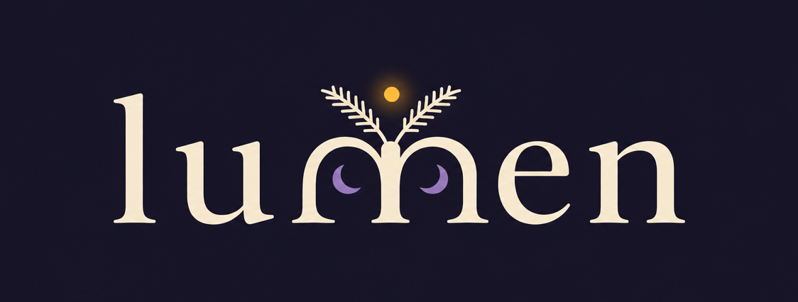
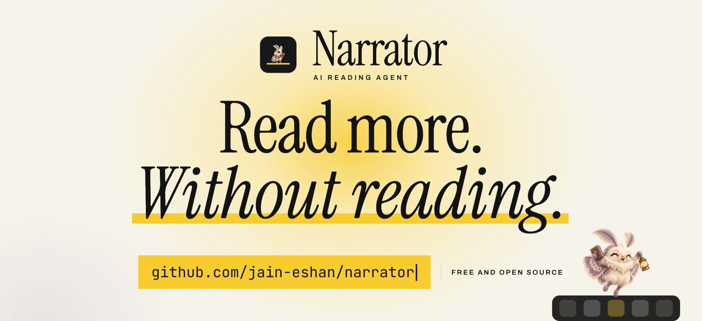

<p align="center"></p>

<p align="center"><b>Lumen reads to you.</b><br>A small moth on your Dock that reads your screen aloud.</p>

<p align="center"><a href="https://github.com/jain-eshan/lumen/releases/latest">Download for Mac</a> · <a href="https://www.eshanjain.com/lumen">Install guide</a> · <a href="https://github.com/jain-eshan/lumen/releases/download/v1.2/narrator-demo.mp4">Watch the 50-second demo</a></p>

<p align="center"><a href="https://github.com/jain-eshan/lumen/releases/latest"></a> <a href="LICENSE"></a> </p>

# Lumen

Lumen, the reading moth for Mac, was called Narrator until version 1.3.2. Same app, new name.

Lumen is a Mac menu bar app for the long stuff you were going to skip: Claude replies, articles, docs, email threads. Point it at any part of your screen and it reads it to you in a natural voice, highlighting each line as it goes. It keeps up with Claude as new replies stream in, and it answers questions about what's on screen. When you want Claude's help with a document, Note for Claude lets you mark parts of it, write a thought on each, and paste them all into a chat at once. Lumen is also the small moth who lives on your Dock and reads along with you.

[](https://github.com/jain-eshan/lumen/releases/download/v1.2/narrator-demo.mp4)

Reading runs entirely on your Mac. The voice is Kokoro, running locally: no tokens, no API keys, no account, and it works offline. Two optional features use your Claude plan through the `claude` command: richer reading direction (off by default) and Ask.

Needs an Apple silicon Mac on macOS 14 or later.

## Install

New to installing Mac apps from outside the App Store? [eshanjain.com/lumen](https://www.eshanjain.com/lumen) walks through every step in plain language.

Download `Lumen.dmg` from the [latest release](https://github.com/jain-eshan/lumen/releases/latest), open it, and drag Lumen to Applications. The app is self-signed rather than signed with an Apple Developer ID, so macOS stops it the first time. On macOS 15 or later, open it once, then go to System Settings > Privacy & Security, scroll down and click Open Anyway. On macOS 14, right-click it and choose Open. The file is about 600 MB because the voice engine and model are inside, so it works offline.

On first launch Lumen flutters down onto your Dock, says hello, and walks you through the Screen Recording and Accessibility permissions. Lumen only looks at the area you select.

**Updating from Narrator?** Quit Narrator, install Lumen as above, then move Narrator from Applications to the Trash. Lumen keeps Narrator's settings, and its Screen Recording and Accessibility permissions should carry over too. If Lumen asks again, switch it on in System Settings. If System Settings still lists Narrator there, that entry is Lumen.

### Connect Claude (optional)

Reading needs nothing more. Two extras use Claude Code with your Claude plan, at no extra cost: Ask, and the richer reading voice.

1. Choose **Connect Claude…** from Lumen's menu bar icon, or press Option + Shift + A. Lumen checks your setup and tells you the next step.
2. If Claude Code isn't installed, follow [Anthropic's install guide](https://code.claude.com/docs/en/setup), then click **Check again**. Lumen also finds the copy of Claude Code that the Claude desktop app keeps, if you have one.
3. If Claude Code isn't signed in, click **Sign in**. A Terminal window opens Claude's own sign-in in your browser, and Lumen connects by itself once you're done.

The menu then shows **Claude connected**. Lumen only uses a Claude plan. If Claude Code is signed in with an API (Console) account, which bills per use, Lumen asks you to sign in with your Claude account instead.

## What it does

- **Point at anything.** Press Option + Shift + 4 and drag over any text on screen.
- **Tune it.** Say what it's for, pick a mood (Calm, Warm, Serious, News, Story, or Auto) and a voice: a woman or a man, with an American or British accent, or Auto to match what you're reading. Click a voice to hear a sample first.
- **Sit back.** It reads line by line and highlights each one as it goes, then scrolls on by itself.
- **Tables make sense.** A table is read row by row, with each value named by its column, instead of column by column.
- **Keep up with Claude.** Follow mode reads new replies as they stream in, scrolls down by itself to read a long reply to the end, and skips your own messages. It switches on when you read a Claude, ChatGPT, Gemini, Perplexity or Copilot window, or when you say you want the replies. Only Claude has been tested so far.
- **Jump.** Click any sentence and it carries on from there.
- **Note for Claude.** Mark parts of any document, write a thought on each, and paste them all into Claude at once. See [Note for Claude](#note-for-claude) below.
- **Ask.** Press Option + Shift + A to ask about what's on screen. Type, or dictate with any dictation app you already use, then press Return. The answer is spoken and also written out in a card that stays until you close it with Esc, with a box underneath for a follow-up. Ask needs Claude connected, as described above.
- **Move any box.** Lumen's boxes (the playback bar, the Ask box and its answer, the purpose box, the note box and the notes tray) can be dragged by their background if one covers something you want to see. They open in the new spot next time.
- **Lumen.** The moth lives on top of your Dock. It wanders and reads to itself, flies over to the icon of the app you're reading, and its mouth and lantern follow the voice. It listens while you ask, thinks while Claude works, and falls asleep after a few quiet minutes. Hover over it for a tip, click it to start or pause, or pick it up and drop it. It steps aside when your pointer is over the Dock below it. It reads where your Dock is and stays on it: if you resize the Dock, move it to another display or hide it, Lumen walks or flutters onto the new spot, and with no Dock at the bottom it stands on the bottom edge of the screen (clear of a Dock at the side). Turn it off from the menu bar, or choose Keep Lumen in one place and it stays wherever you drop it, with no wandering or following. With Reduce Motion on, it stays put.

## Note for Claude

1. Click Lumen and choose **Note for Claude**, or choose **Note for Claude…** from the menu bar.
2. Drag over a part of any document, then type or dictate your thought on it. Repeat as you scroll, up to 10 parts.
3. Click **Copy all**, then paste into any Claude chat or project.

Copy all puts a short message and your notes file on your clipboard, and saves the file in Downloads too. Your notes travel inside the file, so they arrive wherever you paste.

- **A PDF on your Mac** (open in Preview or another Mac app, or opened from Downloads in Chrome, Safari, Arc, Edge or Brave): the file is a marked-up copy, with your notes highlighted and numbered where they belong and a first page listing every note.
- **Another document on your Mac** (a Word file, for example): a notes PDF, described below, with the original file attached next to it so Claude can read all of it.
- **Anything else** (web pages, a document open in your browser that you haven't downloaded, other apps): the file is a notes PDF. Its first page says what you want and where the parts come from, then each part gets a page with the text you marked, a numbered picture of it, and your note. For a document open in your browser, Lumen tells you that downloading it gets you a marked-up copy instead.

In the tray, before you copy:

- **What should Claude do?** is an optional box for your request. It goes on the first page.
- **Text only** leaves a part's picture out and sends just its text, which keeps the file small.
- **Send marked-up copy** (for a PDF) or **Send whole file** (for other documents) starts on for a file on your Mac, unless it's over 100 pages or 30 MB. The tray shows its size in pages or megabytes, and an estimate in tokens for a PDF. Turn it off to send only the notes PDF.
- **Remove link** keeps a browser tab's address out of what you send.
- **Snip another** adds the next part.

Note for Claude doesn't need Claude connected. It only uses your clipboard.

**History.** Choose **History…** from the menu bar or Lumen's right-click menu to see your past sets and copy any of them again, along with a list of what Lumen read aloud, for the last 30 days. Notes are saved as you go: close the tray with × or Done and the set stays in History, or click Delete to remove it. If Lumen quits with the tray open, the set comes back next time.

## Shortcuts

All shortcuts use Option + Shift.

| Keys | What it does |
|---|---|
| Option + Shift + 4 | Select an area to read |
| Option + Shift + Space | Play or pause |
| Option + Shift + , | Skip back |
| Option + Shift + . | Skip forward |
| Option + Shift + A | Ask a question. Press again to send it, or to close the box when it's empty. With an answer showing, it goes to the follow-up box |
| Option + Shift + J | Jump to a sentence |
| Esc | Cancel a selection or jump, or close an answer |

## Privacy

- **Reading stays on your Mac.** Lumen looks only at the area you select, reads its text with macOS's own text recognition, and speaks it with the voice model inside the app. Nothing is uploaded. There is no account, no analytics and no tracking.
- **Claude features send text only when you use them.** With "Richer voice with Claude" on, the text in your reading area goes to Claude to plan the reading. Ask sends your question, the sentence being read, and the text in the reading area (or in the window under your pointer when nothing is being read), and Claude may search the web to answer. Both run through your own `claude` command and your Claude plan. Lumen never uses an API key.
- **Note for Claude sends nothing itself.** The parts you mark, their text, your notes, the file location or tab link, and any attached file go only to your clipboard, for you to paste. A marked-up PDF or notes PDF is a new file in your Downloads folder (macOS asks once if Lumen may save there), and your original PDF is never changed. To read a tab's link, Lumen asks the browser, and macOS asks you to allow that once per browser.
- **What stays on disk.** Your settings (voice, mood, speed, and what you asked it to read in each app) are kept in macOS preferences. A diagnostic log at `~/Library/Logs/Narrator/narrator.log` records events such as which app was read and how long things took, never the text itself. History, at `~/Library/Application Support/Narrator/History`, keeps your Note for Claude sets (the marked parts, their text, your notes and requests, and where they came from) and a list of what was read aloud by date, app and window title, never the text. Anything older than 30 days is deleted automatically, and Delete in the tray removes a set straight away.

## Known limits and what's being worked on

Lumen is young and small, so here is what to expect. Each item links to its issue, where you can follow it or add what you know.

- **Apple silicon and macOS 14 or later only.** The voice runs on MLX, which needs Apple silicon. Intel Macs are not supported.
- **macOS shows an "unidentified developer" prompt the first time.** The app is self-signed. [Signed and notarized builds](https://github.com/jain-eshan/lumen/issues/18) need a paid Apple Developer membership.
- **Follow is tested with the Claude desktop app only.** [Other chat apps](https://github.com/jain-eshan/lumen/issues/17) are untried. Its checks read a drawn copy of the Claude chat, and [testing against the real app](https://github.com/jain-eshan/lumen/issues/13) is still to do.
- **Follow sometimes starts late.** One report of a reply read only after a keypress is still [being investigated](https://github.com/jain-eshan/lumen/issues/12).
- **Follow tells your messages from Claude's by position.** [It can misjudge](https://github.com/jain-eshan/lumen/issues/16) an unusual layout, and its [safety net](https://github.com/jain-eshan/lumen/issues/15) may repeat a sentence on rare occasions.
- **The build steps** have [not been tried on a clean Mac](https://github.com/jain-eshan/lumen/issues/19).
- **The demo video** still says Narrator ([to re-render](https://github.com/jain-eshan/lumen/issues/20)).

All open items are in [Issues](https://github.com/jain-eshan/lumen/issues), and what changed in each version is in the [changelog](CHANGELOG.md).

## Troubleshooting

- **Nothing happens when I press Option + Shift + 4.** Check that Lumen is in System Settings > Privacy & Security under both Screen Recording and Accessibility, then quit and reopen it.
- **Follow did not read a reply.** Open `~/Library/Logs/Narrator/narrator.log`. Lines such as `scrolled`, `reached the end of the page`, `paused` and `guard:` show what Lumen decided. The log records events only, never the text on screen. If it did not explain things, [open an issue](https://github.com/jain-eshan/lumen/issues/new/choose) with the last 100 lines.
- **Lumen asks for permissions again after an update.** Switch it on in System Settings. If a Narrator entry is listed there, that entry is Lumen.
- **I selected a wide area and it read the side panel too.** Lumen reads everything inside the area. Select only the column you want, or say what you want read, such as "Claude's replies".

## Contributing

Bug reports with a log excerpt are the most useful thing you can send. Code changes are welcome too: [CONTRIBUTING.md](CONTRIBUTING.md) covers the checks to run and how to add a failure to the eval. Security problems go through [SECURITY.md](SECURITY.md), not a public issue.

## Uninstall

Quit Lumen from the menu bar, then run the two commands below. Lumen still uses Narrator's internal names for its settings, log, history and voice cache, so updates from Narrator keep your settings. That's why the paths say narrator.

```bash
rm -rf /Applications/Lumen.app /Applications/Narrator.app ~/Library/Logs/Narrator ~/.cache/narrator-espeak "$HOME/Library/Application Support/Narrator"
```

```bash
defaults delete local.narrator.app
```

You can also remove Lumen from Screen Recording and Accessibility in System Settings, under Privacy & Security.

## Build it

You need Xcode command line tools and [uv](https://docs.astral.sh/uv/). The app is a handful of Swift files in `app/`, plus a Python voice service, `scripts/kokoro_server.py`.

```bash
uv venv envs/kokoro --python 3.12
uv pip install --python envs/kokoro/bin/python -r requirements.txt
HF_HOME=models envs/kokoro/bin/python -c "from huggingface_hub import snapshot_download; snapshot_download('mlx-community/Kokoro-82M-bf16')"
```

The text tools in `requirements.txt` pull in PyTorch, but the voice runs on MLX and never uses it, so `build.sh` leaves PyTorch and its companions out of the app.

Create a self-signed code signing identity and put its files in `.signing/` (`identity`, `keychain-password`, `narrator.keychain-db`). `build.sh` reads them. Then:

```bash
zsh app/build.sh --full    # builds Lumen.app with the voice engine and model inside (about 1 GB)
zsh app/package.sh         # optional: makes dist/Lumen.dmg to share
```

These steps have not been tried on a clean machine yet. If one fails, please open an issue.

### Check a change

The reading logic has its own checks, and the app can draw its playback bar, boxes and Lumen's poses to images, so you can see a visual change without clicking through it:

```bash
Lumen.app/Contents/MacOS/Lumen --selftest
```

```bash
mkdir -p /tmp/previews && Lumen.app/Contents/MacOS/Lumen --render-ui=/tmp/previews
```

Follow mode, which reads a chat as the replies arrive, also has an eval. It reads a drawn stand-in for the Claude chat, with a long reply that runs below the screen, the user's own message, a side panel and a folded thinking line, and checks what Lumen would speak. Nothing shows on screen and the cursor is not touched, so the computer stays usable. Run it before a release, and add a scenario for every failure reported from real use:

```bash
evals/run.sh Lumen.app
```

GitHub runs the self-tests, a check that the app draws its screens, and this eval on every pull request and every push to `main` ([`.github/workflows/checks.yml`](.github/workflows/checks.yml)). It builds the app with plain `swiftc`, so it does not cover the signed app, the voice engine or sound.

## Lumen's art

The logo, wordmark, colours and voice live in [`brand/`](brand/BRAND.md). Read `brand/BRAND.md` before making anything with the Lumen name on it.

Lumen's ten poses (reading, reading aloud, two walking steps, flying, waving, listening, thinking, celebrating, asleep) live in `app/lumen/` as transparent PNGs. They were made from one generated pose sheet, `art/lumen-sheet.png`, which was generated with an image model using `art/lumen-concept.jpg` as the character reference. `art/cutout.swift` uses Apple's Vision to cut each pose out, put them all on one canvas at one scale with the feet on the bottom edge, and clean the white edges:

```bash
swiftc -O art/cutout.swift -o /tmp/cutout
/tmp/cutout art/lumen-sheet.png app/lumen read talk walk1 walk2 fly wave listen think cheer sleep
```

The app finds the lantern in each pose by itself, so a new sheet needs no measuring. Keep the same ten poses in the same order.

## Demo video

The demo is a [HyperFrames](https://hyperframes.heygen.com) project in `videos/narrator-demo/`, built from the app's real parts: Lumen's poses and the purpose box, Ask box and playback bar as rendered by the app itself (`--render-ui`). It is narrated in the app's own default voice (Kokoro, Heart) and made entirely on this Mac. It was made before the rename, so it says Narrator. `BRIEF.md` holds the brand and audience, `STORYBOARD.md` the eight frames shot by shot, and `SCRIPT.md` the narration. `videos/narrator-demo/tools/README.txt` lists the rebuild steps. The narration, mixed music bed and renders are generated, so they are not in git.

## Layout

- `app/*.swift`: the app, one file per part:
  - `Reading.swift`: turns recognized screen text into spoken phrases
  - `Claude.swift`: the optional Claude reading direction, Ask, and the on-device director
  - `Speech.swift`: talks to the voice service, plus the diagnostic log
  - `Screen.swift`: screen capture, scrolling and window lookup
  - `Views.swift`: the selector, highlight, jump picker and shared visual style
  - `Lumen.swift`: Lumen on the Dock and its speech bubble
  - `Notes.swift`: Note for Claude: the marked parts, the tray, and the marked-up or notes PDF
  - `History.swift`: the History window and the 30-day store behind it
  - `App.swift`: the menu bar app that ties it all together
  - `SelfTest.swift`: checks run with `--selftest`
  - `Simulation.swift`: the drawn chat that `evals/run.sh` reads
  - `main.swift`: starts the app
- `evals/run.sh`: the Follow mode eval, one line per failure that was reported
- `CHANGELOG.md`, `CONTRIBUTING.md`, `SECURITY.md`, `.github/`: release history, how to help, how to report a vulnerability, and the issue and pull request forms
- `app/build.sh`, `app/package.sh`: build and disk image
- `app/lumen/`: Lumen's poses, bundled into the app
- `brand/`: the brand guide, logo, wordmark and colours
- `art/`: Lumen's concept, pose sheet, the cut-out tool and the logo source images
- `videos/narrator-demo/`: the demo video's sources and tools
- `docs/`: images used in this README
- `scripts/kokoro_server.py`: the speech service the app starts
- `scripts/`: the other files are voice experiments from early development
- `requirements.txt`: the pinned Python packages
- `LICENSE`: GPL-3.0

## Made by

Lumen is designed, built and maintained by [Eshan Jain](https://www.eshanjain.com). The product page is at [eshanjain.com/lumen](https://www.eshanjain.com/lumen).

## Credits

- Voice: [Kokoro-82M](https://huggingface.co/hexgrad/Kokoro-82M) (Apache-2.0), run with [mlx-audio](https://github.com/Blaizzy/mlx-audio).
- Lumen: an original character, generated with an image model and cut out with Apple's Vision.
- Demo music: "Blue Skies" by [Holizna](https://freemusicarchive.org/music/holiznacc0/), CC0 1.0, from Free Music Archive.
- Demo sound effects: Pixabay Content License, bundled with HyperFrames.
- Demo fonts: Instrument Serif and Archivo, SIL Open Font License 1.1 (`videos/narrator-demo/assets/fonts/LICENSE.txt`).

## License

Lumen is licensed under the [GNU General Public License v3.0](LICENSE). The voice stack includes espeak-ng and phonemizer, which are GPL licensed, so the whole app is released under the GPL. This repository is the source for every release.

The app is signed with a self-signed identity. A paid Apple Developer ID would remove the "unidentified developer" prompt.
